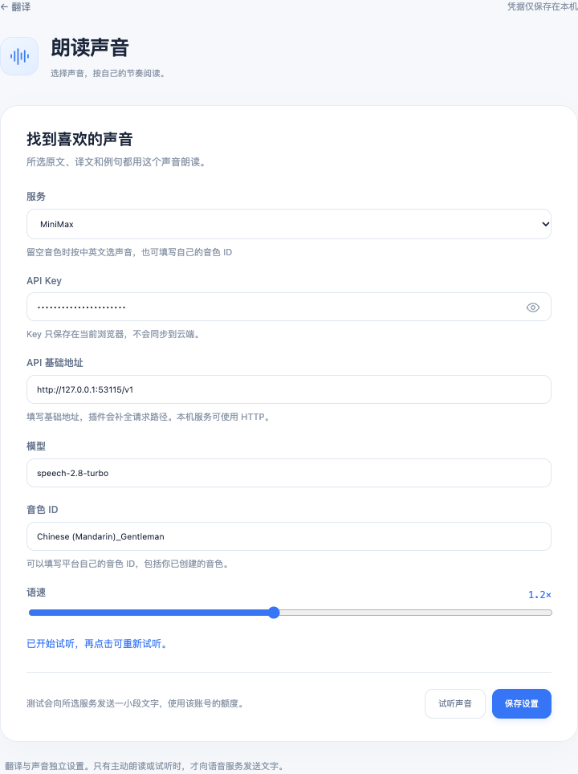

# Chrome Translate

[简体中文](README.md) · English

[](https://github.com/ALVIN-YANG/chrome-translate/actions/workflows/check.yml)
[](https://github.com/ALVIN-YANG/chrome-translate/releases/latest)
[](LICENSE)

Select text to **translate it or read it aloud**. This Chrome extension also provides bilingual webpages and a text workspace, with 15 translation languages and your choice of translation and speech services.

**Microsoft translation and local system speech need no API key.** Cloud voices are optional.

**[Download](https://github.com/ALVIN-YANG/chrome-translate/releases/latest)** · [Install](#install) · [Voices](#voices) · [Report an issue](https://github.com/ALVIN-YANG/chrome-translate/issues/new/choose)

## Install

Requires Chrome 120+. Release packages need no Node.js or developer account.

1. Download `translate-chrome-*.zip` from [Releases](https://github.com/ALVIN-YANG/chrome-translate/releases/latest) and extract it to a permanent folder.
2. Open `chrome://extensions`, enable **Developer mode**, and click **Load unpacked**.
3. Select the folder directly containing `manifest.json`.
4. Open **翻译 · 多语言** from Chrome's extensions menu. Choose the first item, **打开翻译界面** (Open translation workspace), and paste `Hello, world.`.
5. Refresh already-open webpages to enable selection translation, speech, and bilingual reading. Pin the extension if desired.

Use the Release package for installation. **Code → Download ZIP** and **Source code** contain source that needs a build.

To update, replace files in the same folder, reload the extension in Chrome's extension manager, then refresh the workspace and webpages. Keep the installation folder in place.

## Select, translate, listen

Selecting text shows two actions: **翻译** (Translate) and **朗读** (Read aloud). Selection alone sends no requests.

- Translation detects the source language. Chinese defaults to English; other languages default to Chinese. Words can show several meanings, contexts, and examples. Sentences and passages normally have one translation.
- Read aloud speaks the selected original text. Use the playback bar to pause, resume, or stop. Esc also stops playback. Long passages are split into segments.


Translations remain selectable and copyable. Each meaning and example has a speech control. For example, “回溯” can include `backtracking`, `backtrack`, and `trace back`, with their contexts. Press Esc or click outside to close. A context-menu action also opens selection translation.


## Voices

Open **朗读声音设置** (Voice settings) from the toolbar menu, workspace, or selection translation panel. Speech settings are independent of translation settings. Edit the API key, base URL, model, voice ID, and speed, then preview the voice.

Supported services: **local system voices, MiniMax, OpenAI, ElevenLabs, SiliconFlow**, and custom endpoints using OpenAI Audio Speech, MiniMax, or ElevenLabs protocols. Local system speech is the default. SiliconFlow speech can reuse its translation key.

For MiniMax's gentle male voice, choose **MiniMax**, enter your key, use model `speech-2.8-turbo`, and set the voice ID to `Chinese (Mandarin)_Gentleman`. Preview and save. This voice is then used for selected originals, translations, and examples. An empty MiniMax voice ID selects a Chinese or English voice automatically; your own platform voice IDs are also supported.



*These selection and voice screenshots come from the running extension with fixture credentials, controlled translation responses, and a local test tone.*

Custom remote endpoints require HTTPS. Loopback services can use HTTP on `localhost` or `127.0.0.1`. Enter the base URL without credentials, query parameters, or fragments; the extension appends the API path and rejects redirects.

System speech selects device-local voices. Translation language support does not guarantee that a matching system voice is installed. Cloud voice availability, permissions, quotas, and billing depend on your provider account.

## Bilingual webpages

Use **翻译当前网页** in the toolbar menu, the floating shortcut, the context menu, or **Alt+A**. Translations appear below the originals. Repeat the action to restore the page. On macOS, use Option for Alt.

The default scope prioritizes article content and translates near the viewport, continuing as you scroll. **翻译整个页面** or **Alt+W** broadens the scope. Code, forms, inputs, editable regions, and explicitly excluded content remain untouched. Links, formatting, and page events are preserved.


The floating shortcut is a **32px circle** with no shadow. Drag it to reposition it; its position is remembered. Arrow keys provide fine adjustment. The menu also offers provider, target-language, selection-toolbar, and floating-shortcut preferences.

Stable new content is translated as pages update. Completed translations are reused after site rerenders; repeated conflicts pause translation and offer Retry. Changing provider or target language restores the original and waits for another explicit start. Refreshing or navigating also requires a new start; document-anchor navigation keeps the current translation. Page caches stay in page memory.

Only normal HTTP/HTTPS text pages are supported. PDF, images, video subtitles, subframes, and website Shadow DOM are outside the current scope. Browser pages, the extension marketplace, and local files cannot be injected. Change conflicting shortcuts at `chrome://extensions/shortcuts`.

## Text workspace and providers


*Workspace image: v0.5.0 with Microsoft translation and Bing Dictionary.*

Paste or edit text to translate immediately. IME composition waits for confirmation. New input cancels old requests; late results cannot replace the current result. Outputs support selection, copy, and speech. Failed updates keep the previous result with a clear label.

Source language defaults to automatic detection. Use the selector above the input to choose any of the 15 supported languages manually. Chinese defaults to English; other languages default to Chinese. The target can also be selected manually.

The input's speech button reads the original without waiting for a translation. Click again to stop. Originals, translations, and examples share your speech settings. Editing the input or changing languages stops playback.

The toolbar's first action reuses an existing workspace tab. Input, provider, source and target languages, and results can survive a tab refresh through `sessionStorage`. Clear has an eight-second undo window. Input is limited to 10,000 characters; Baidu also has a 6,000-byte limit.

| Provider | Credentials | Default use |
| --- | --- | --- |
| Microsoft | None | Keyless translation; Bing enrichment for short Chinese/English words |
| Baidu | App ID and secret | Official general text translation |
| Zhipu | API key | `glm-4.7-flash`, meanings and examples |
| SiliconFlow | API key | `tencent/Hunyuan-MT-7B`, dedicated translation |
| Gemini | Google AI Studio key | `gemini-3.1-flash-lite`, meanings and examples |
| DeepSeek | API key, editable model | `deepseek-flash`, meanings and examples |
| Kimi Coding Plan | Coding Plan key, editable model | `kimi-for-coding`, meanings |

Configure translation credentials from the workspace's **设置** (Settings) button. Failures do not trigger automatic retries or provider fallback. Microsoft uses a keyless Edge consumer endpoint without a third-party stability guarantee. Kimi's Coding Plan has its own permitted-use rules. Free tiers can have regional, quota, billing, and data-use restrictions; see the [provider notes](docs/免费模型说明.md), checked on 2026-10-09. Gemini's free tier may use content to improve Google's products.

Translation languages: Chinese, English, Japanese, Korean, French, German, Spanish, Portuguese, Russian, Italian, Arabic, Hindi, Thai, Vietnamese, and Indonesian. Arabic supports right-to-left reading. Short ambiguous input may need context. Generated meanings and examples can be inaccurate.

## Privacy

Text goes directly to the chosen translation or speech provider. Microsoft short-word enrichment also queries Bing Dictionary. Page URLs, cookies, and full HTML are not sent to translation providers.

Keys and preferences stay in trusted extension-local storage, not browser cloud sync. Content scripts receive public settings only. Workspace state uses tab `sessionStorage`; browser session restoration may restore it. The extension has no translation-history database, relay backend, analytics, advertising, or remote scripts.

Permissions: `storage`, `contextMenus`, `offscreen`, and access to normal HTTP/HTTPS pages. No microphone, clipboard-read, `tabs`, or browsing-history permission is requested. Cloud audio is synthesized and played in a trusted offscreen document. Cancelling a request does not guarantee that server computation or billing stops. See [data and permissions](docs/隐私说明.md) and [SECURITY.md](SECURITY.md).

## Develop and verify

Use Node.js 22+.

```sh
git clone https://github.com/ALVIN-YANG/chrome-translate.git
cd chrome-translate
npm ci
npm run check
npx playwright install --no-shell chromium
npm run test:browser
npm run package
```

The browser suite extracts the actual ZIP and loads it in isolated Chromium profiles. It tests translation, copy, voice configuration compatibility, audio controls, CSP, keyboard access, and dynamic pages using fixture responses and a local test tone. It needs no real keys. Linux may require `--with-deps` for browser dependencies.

[GitHub Actions](https://github.com/ALVIN-YANG/chrome-translate/actions/workflows/check.yml) checks Node 22/24 and Chromium. ZIP and SHA-256 files go to `output/release/`. Failed browser checks preserve screenshots and traces. Controlled checks do not prove account authorization, translation quality, or human listening quality. See [validation notes](docs/验证记录.md).

`npm run dev` opens a workspace preview at `http://127.0.0.1:4173`; selection and webpage translation require the installed extension. Preview keys stay in current-page memory and clear on refresh.

Model translation and cloud speech use [AI SDK](https://ai-sdk.dev/docs/introduction) providers plus a MiniMax SpeechModelV4 adapter. Microsoft and Baidu use their own protocols. Positioning uses [Floating UI](https://floating-ui.com/) and icons use [Lucide](https://lucide.dev/). Dependency licenses are included in the package.

## License

Source and documentation use the [MIT License](LICENSE). Provider accounts and APIs remain subject to their own terms.

[Contributing](CONTRIBUTING.md) · [Code map](docs/架构说明.md) · [Release instructions](docs/发布说明.md) · [Roadmap](docs/路线图.md)
